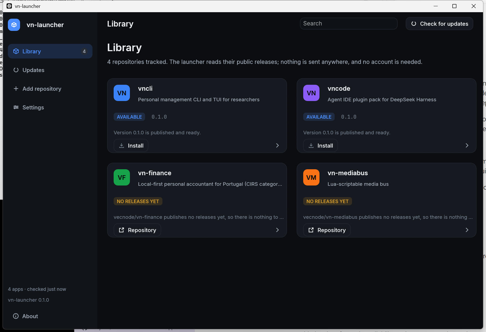
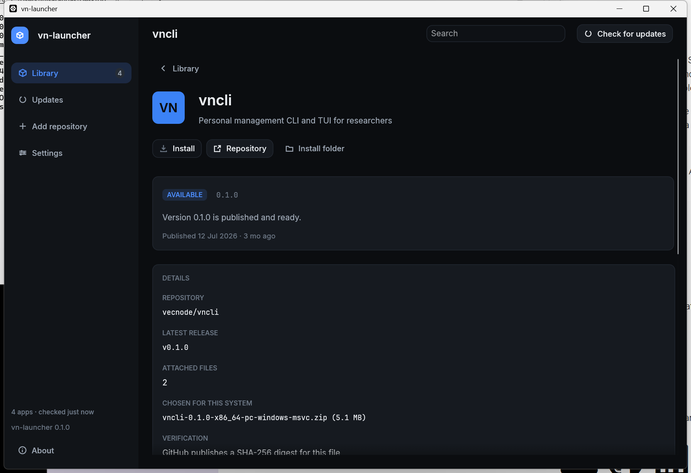

<div align="center">

# vn-launcher

**One window for the vecnode applications.** See what is on this machine, what each
repository has published, and start what you already have.

[](https://github.com/vecnode/vn-launcher/actions/workflows/ci.yml)
[](LICENSE)
[](https://github.com/vecnode/vn-launcher/releases)

[](#requirements)
[](#requirements)
[](https://github.com/emilk/egui)
[](#design-decisions)

[](#supported-platforms)
[](https://github.com/vecnode/vn-launcher)
[](#repository-layout)
[](#no-account-no-token-no-sign--in)

</div>

---

<div align="center">



<sub>The library after a check. Two repositories publish a release; two do not yet.</sub>

</div>

---

## What it does

vn-launcher is a native desktop application that keeps track of the vecnode apps on
your machine and tells you the truth about them.

- **Tracks what is installed.** It looks in the places each app declares and on
  `PATH`, and it distinguishes an app *it* installed from one it merely *found* —
  because only the first can be updated or removed safely.
- **Reads every repository's public releases.** It works out which attached file
  belongs on your operating system and CPU, and says so plainly when there is none
  rather than offering you the wrong build.
- **Refuses to guess.** If a release has two files that fit equally well, the
  launcher stops and tells you instead of picking one.
- **Starts what you have.** Launching works today, for anything it can find.
- **Lets you add any public repository.** No account, no token, no sign-in, no
  plugin to install. Paste an `owner/repo` and the launcher shows you what it found
  before you commit to it.

## What it does not do yet

**Downloading, installing, updating and removing are deliberately not switched on.**
The launcher can already read releases and choose the right file; doing the rest
correctly depends on every repository publishing releases the same way, and they do
not yet.

That agreement is written down, with a copy-and-paste workflow and a per-repository
checklist, in **[docs/RELEASES.md](docs/RELEASES.md)**.

The interface shows the disabled button and explains why on hover, rather than
pretending the feature is absent.

## Looking inside an app

<div align="center">



<sub>Which attached file was chosen for this machine, and what is known about it.</sub>

</div>

Every claim the launcher makes is traceable. The detail page names the release it
read, the exact file it would take for this machine and its size, whether a SHA-256
digest is published for it, where it would be installed, and every location that was
searched for an existing copy. When there is nothing to install, it says which of
the possible reasons applies rather than leaving a blank.

A light theme is included; the theme follows the system by default and can be pinned
in Settings.

## Supported platforms

| | Windows | macOS | Linux |
|---|---|---|---|
| Builds and tests on every push | ✅ | ✅ | ✅ |
| Development verified locally | ✅ | not yet | not yet |
| Tray icon and notifications | planned | planned | planned |
| Prebuilt releases | planned | planned | planned |

The interface is written against egui's own layout and painting, with embedded
typefaces and vector marks, so nothing about it depends on which system font or
window manager is in use.

## Requirements

- **Rust 1.95 or newer** (egui 0.36 requires it) and **edition 2024**.
- A GPU or software renderer that supports wgpu, which every current desktop has.
- No Node, no Python, no system webview, and nothing to install at runtime.

## Build and run

```bash
git clone https://github.com/vecnode/vn-launcher
cd vn-launcher

cargo xtask ci      # formatting, lints and tests — exactly what CI runs
cargo run --release # the launcher
```

`cargo xtask` is the project's task runner; `cargo xtask help` lists what it can do.

## Adding a repository

The launcher's catalog is data, not code. Two files are merged, later over the
earlier, entry by entry:

| Layer | Where | Purpose |
|---|---|---|
| Built-in | [`assets/catalog/apps.toml`](assets/catalog/apps.toml) | The four apps that ship |
| Yours | Platform config directory | Whatever you add or override |

Nothing in the built-in catalog is hard-coded in Rust, so adding a repository is a
line in a text file rather than a rebuild. The **Add repository** tab in the
application does this for you: it reads the repository, shows how many releases it
has and which file it would pick for *your* machine, and writes the entry only once
you confirm.

An entry is usually three lines, because stems, extensions, platform matching and
version comparison are all worked out from the repository:

```toml
[[app]]
id    = "my-tool"
name  = "My Tool"
repo  = "someone/my-tool"
```

Everything else — brand colour, asset stems, launch command, detection paths — is
inferred, and can be overridden when the inference is wrong. See
[docs/CATALOG.md](docs/CATALOG.md) and [docs/MANIFEST.md](docs/MANIFEST.md).

## No account, no token, no sign-in

Every request goes to GitHub's public API as an anonymous guest. There is no token
field, because there is no token. Releases are read at most once per interval
(6 hours by default) and the answer is cached on disk, so a launcher left open does
not keep asking.

## Design decisions

**Rust, egui and eframe — no webview.** A launcher is a small program that must
start instantly and behave identically on three operating systems. A bundled browser
engine is several hundred megabytes and three more ways to fail. The same reasoning
rules out Electron.

**The core is pure.** [`crates/core`](crates/core) has no filesystem, no network and
no clock. Which release is newest, which file belongs on this machine, whether what
is installed is actually older — all of it is ordinary functions over ordinary data,
with a test next to each. [`crates/native`](crates/native) is the only crate that
touches the world, and [`crates/ui`](crates/ui) never does.

**Everything from the network is hostile.** Responses and downloads are read through
hard byte caps, archive entries that would escape the extraction root are rejected,
and URLs are validated before they are handed to the operating system.

**Nothing panics.** `unsafe` is forbidden workspace-wide and `unwrap`, `expect` and
`panic!` are denied outside tests: a bad release payload or a hand-edited catalog is
a value to report, not a crash.

## Repository layout

```text
crates/
  core      vnl-core     pure: catalog, release parsing, asset choice, versions, status
  native    vnl-native   desktop: paths, HTTP, feed cache, detection, process launching
  ui        vnl-ui       egui: theme, fonts, icons, widgets, the five views
apps/
  vn-launcher            the eframe shell that ties them together
xtask/                   cargo xtask ci | fmt | lint | test | version
assets/
  catalog/apps.toml      the catalog that ships
  fonts/                 Inter and JetBrains Mono, under the SIL OFL
docs/                    ARCHITECTURE, CATALOG, MANIFEST, RELEASES
```

## Documentation

| Document | What it answers |
|---|---|
| [docs/ARCHITECTURE.md](docs/ARCHITECTURE.md) | Why the crates are split the way they are |
| [docs/CATALOG.md](docs/CATALOG.md) | Where the catalog lives and how the layers merge |
| [docs/MANIFEST.md](docs/MANIFEST.md) | Every field an app entry can set |
| [docs/RELEASES.md](docs/RELEASES.md) | **The release convention every repository must follow** |

## Licence

MIT — see [LICENSE](LICENSE).

The bundled typefaces are **Inter** and **JetBrains Mono**, both under the SIL Open
Font License 1.1; their licence texts are in [`assets/fonts/`](assets/fonts).
